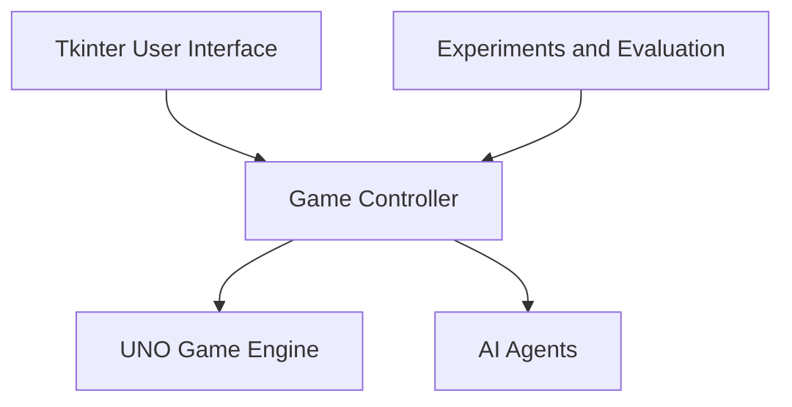

# System Architecture and Game Rules

## 1. Design Goals

The project follows a modular design that separates the UNO game engine, AI agents, graphical interface, and experimental evaluation.

This structure allows different AI strategies to play under the same rules without requiring changes to the core game logic. It also makes it easier to test individual components, compare agent performance, and extend the project.

## 2. System Architecture

The application is organized into five main components: the game engine, AI agents, game controller, user interface, and experiments.

The `GameController` connects the game engine with the AI agents. It manages turns, requests decisions from agents, applies those decisions to the game, and records performance information.

The Tkinter interface uses the controller to display live matches, while the experiment modules use it to run automated games and collect results.

The game engine handles the rules independently of the AI algorithms. This allows all agents to be evaluated using the same gameplay implementation.

## 3. Module Responsibilities

### 3.1 Game Engine — `uno_game/`

This package contains the main UNO game logic, including the deck, cards, players, legal moves, turn order, and winning conditions.

| File | Responsibility |
|---|---|
| `card.py` | Defines card colors, types, and point values |
| `deck.py` | Creates, shuffles, and manages the draw pile |
| `player.py` | Manages player hands |
| `rules.py` | Checks which cards can legally be played |
| `game.py` | Controls turns, applies card effects, and determines the winner |

The game engine does not decide which card an AI should play. It only checks and executes game actions according to the rules.

### 3.2 AI Agents — `agents/`

This package contains the decision-making algorithms used by the computer-controlled players.

| File | Agent |
|---|---|
| `base_agent.py` | Defines the common agent interface and observation structure |
| `random_agent.py` | Random Agent |
| `greedy_agent.py` | Greedy Agent |
| `heuristic_agent.py` | Heuristic / Rule-Based Agent |
| `monte_carlo_agent.py` | Monte Carlo V1 Agent |
| `monte_carlo_v2_agent.py` | Monte Carlo V2 Agent |

Each agent receives an `AgentObservation` object and returns an `AgentDecision`. This common interface allows the controller to use different strategies without changing how the game is executed.

### 3.3 Interface and Controller — `interface/`

This package connects the game engine and AI agents and provides the live graphical demonstration.

| File | Responsibility |
|---|---|
| `game_controller.py` | Executes AI turns and records decisions and execution times |
| `demo_config.py` | Creates games with configurable AI lineups |
| `game_view.py` | Prepares game information for display |
| `uno_gui.py` | Provides the Tkinter graphical interface |
| `async_turn.py` | Runs AI calculations in a background thread to keep the GUI responsive |

The interface supports manual turn advancement, automatic gameplay, pausing, new-game configuration, and live decision statistics.

It also includes an optional audience mode that reveals all player hands during demonstrations.

### 3.4 Experiments — `experiments/`

The experiments package runs automated games to measure and compare the performance of the AI agents.

The main experiments include:

- Four-agent performance comparison
- Baseline and extended UNO ruleset validation
- Monte Carlo simulation budget comparison
- Monte Carlo V1 versus V2 comparison
- Statistical analysis and visualization
- Final system integration checks

Experiment results are saved as CSV files, with charts generated using Matplotlib. A consolidated analysis summarizes the measured results and their limitations.

### 3.5 Automated Tests — `tests/`

The tests package contains unit and integration tests for the game engine, AI agents, rules, experiment calculations, reports, and interface configuration.

The tests help verify that the different components work correctly, both individually and together.

## 4. Information Available to AI Agents

UNO is a game with hidden information because players cannot see their opponents' cards.

To maintain fair gameplay, the AI agents receive only the information they are allowed to use.

An `AgentObservation` contains:

1. The agent's own hand
2. The cards it can legally play
3. The top card on the discard pile
4. The currently active color

Agents do not receive their opponents' actual hands, the draw pile, or unrestricted access to the game state.

The Monte Carlo agents estimate possible future situations using hypothetical cards rather than inspecting real hidden information.

The GUI can reveal all hands for classroom demonstrations, but this option only changes what the audience sees. It does not change the information provided to the AI agents.

## 5. UNO Game Rules

The project implements a simplified four-player version of UNO with two available rulesets.

### 5.1 Baseline Ruleset — 104 Cards

The baseline version includes:

- Number cards in four colors
- Skip cards
- Reverse cards
- Draw Two cards
- Wild cards

Wild Draw Four cards are excluded from this version.

The baseline ruleset is used for the main AI comparisons.

### 5.2 Extended Ruleset — 108 Cards

The extended version adds four Wild Draw Four cards to the baseline deck.

A Wild Draw Four can only be played when the player has no other card matching the active color.

When played, the player selects the next active color, and the following player draws four cards and loses a turn.

The project does not implement the Wild Draw Four challenge rule.

### 5.3 Gameplay Rules and Simplifications

The following rules are used in both versions unless otherwise specified:

- Four players participate in each game.
- Every player starts with seven cards.
- Players take turns playing cards that match the current color, number, or action type.
- Wild cards allow the player to choose a new active color.
- Skip causes the next player to lose a turn.
- Reverse changes the direction of play.
- Draw Two causes the next player to draw two cards and lose a turn.
- If a player has no playable card, the player draws one card and passes.
- Card stacking and jump-ins are not supported.
- Calling penalties are not implemented.
- The game automatically announces "UNO!" when a player has one card remaining.
- A player wins immediately after playing their last card.

These simplifications keep the rules consistent and make automated AI comparisons easier to manage.

## 6. AI Decision-Making Strategies

The project compares four primary AI strategies. Monte Carlo V2 was added as an additional experiment to study improvements in simulation behavior.

### 6.1 Random Agent

The Random Agent selects a move randomly from the available legal actions.

It does not consider card values, hand composition, or future turns.

This agent serves as a baseline for evaluating whether more advanced decision-making strategies provide measurable benefits.

### 6.2 Greedy Agent

The Greedy Agent selects the legal card with the highest point value.

Its goal is to reduce the total points remaining in its hand as quickly as possible.

When playing a Wild card, it chooses a color based on the cards remaining in its hand.

### 6.3 Heuristic / Rule-Based Agent

The Heuristic Agent assigns a score to each legal move using several factors:

- Card point value
- Number of cards remaining in the same color
- Benefits of special action cards
- Preference for saving Wild cards when possible
- Adjustments for situations where the player has few cards remaining

The agent selects the move with the highest heuristic score.

Unlike the Greedy Agent, it considers multiple factors rather than only the value of the card being discarded.

### 6.4 Monte Carlo V1 Agent

Monte Carlo V1 evaluates possible actions by simulating multiple approximate future outcomes.

For each candidate move, it performs a configurable number of simulations and calculates an average reward.

The reward favors reducing the remaining hand size and point total, with a larger reward for winning.

Because the simulations use an approximate model of future gameplay, they do not represent complete four-player UNO matches.

### 6.5 Monte Carlo V2 Agent

Monte Carlo V2 extends the original approach by improving how hypothetical opponent moves are modeled.

Instead of allowing arbitrary changes to the top discard during a rollout, V2 samples a hypothetical opponent hand and uses the game's legal-move rules to determine which cards could be played.

This makes individual simulated opponent moves more consistent with the UNO rules.

However, V2 still uses a simplified model. It does not maintain complete opponent hands across a full four-player simulation or reproduce every action-card effect during rollouts.

The original Monte Carlo agent was retained so that both versions could be compared experimentally.

## 7. Game Turn Execution

During a game, the controller keeps track of whose turn it is and sends the current game information to that player's AI agent. The agent checks the cards it can play and chooses a move. The game engine then checks the move, applies any card effects, and determines whose turn comes next.

After each move, the controller records what happened and how long the agent took to decide. The GUI updates to show the latest state of the game. This process continues until someone plays their last card or the game reaches the turn limit.

## 8. Design Decisions and Limitations

The main advantage of this architecture is that the components are independent enough to be tested and developed separately.

New AI strategies can be added without modifying the UNO rules, and experiments can compare different agents using consistent game configurations.

The Monte Carlo implementations use limited-horizon, approximate simulations to keep decision times manageable. This reduces computational cost but also limits how accurately future game situations are represented.

The Tkinter GUI is primarily intended for observing matches and demonstrating agent behavior. The automated tournament experiments provide the main evidence for comparing AI performance.

Although the project includes statistical analysis and confidence intervals, the relatively small tournament samples mean that observed performance differences should not automatically be treated as statistically conclusive.